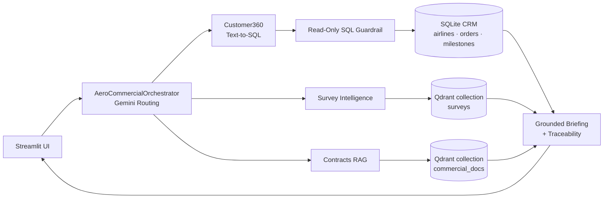
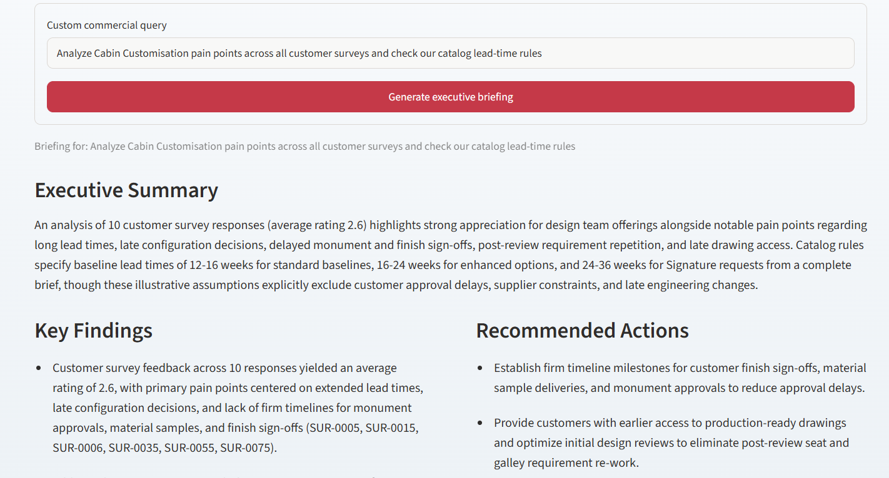
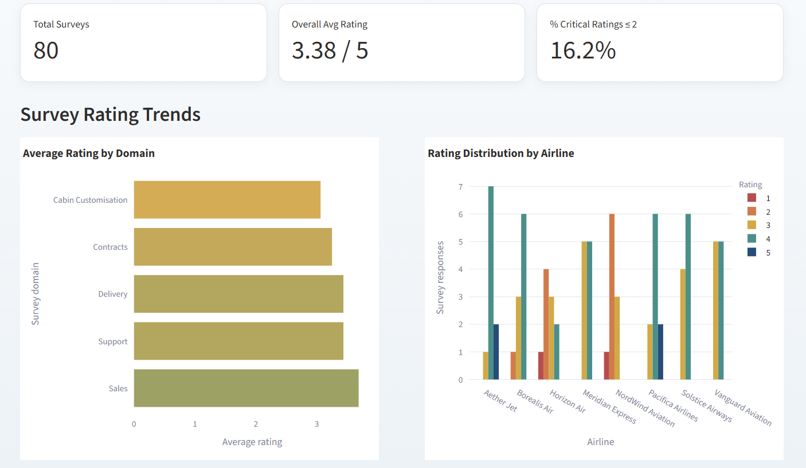

# Aero Commercial Agentic Copilot

An evidence-grounded commercial intelligence prototype for an Aerospace Commercial Digital Office spanning Sales, Marketing, Contracts, and Cabin Customisation.

## Executive Overview & Value Proposition

Commercial teams often prepare account briefings by piecing together fragmented CRM records, post-delivery customer survey feedback, and rules buried in service-level agreements (SLAs), customisation catalogs, and commercial guidance. That manual synthesis takes time, makes emerging risks harder to spot, and can leave recommendations disconnected from their evidence.

The Aero Commercial Agentic Copilot brings those sources together behind a governed, multi-agent workflow. Ask a commercial question and the copilot routes focused sub-queries to specialist agents, then returns an executive briefing with findings, recommended actions, citations, and an orchestration trace. This helps teams prepare for customer meetings and investigate account risks in seconds, while keeping the underlying evidence visible for review.

The included data is fictional and deterministic, generated for demonstration. This repository is a proof of concept (PoC), not a production decision system.

## Architecture



The orchestrator uses Gemini to route and synthesize. Specialized agents retrieve or query only their relevant sources; the final response carries citations and traces so reviewers can inspect the evidence and agent activity.

## Key Features & Demo Preview

- **Customer 360 SQL** answers account, fleet, order, and milestone questions against SQLite. A read-only SQL guardrail rejects non-`SELECT` statements and multi-statement queries before execution.
- **Survey Intelligence** retrieves relevant customer verbatims from Qdrant, summarizes pain points and positive signals, and cites the originating `survey_id`s.
- **Contracts RAG** retrieves commercial document sections and grounds guidance in the cited `source_file :: section_title`.
- **Voice of Customer analytics** provides rating KPIs, interactive Plotly views by domain and airline, and a filterable verbatim explorer.
- **Traceability** exposes each agent, tool, executed SQL or retrieval query, result summary, latency, and sources in the briefing trace.
- **Human review** remains essential: recommendations are decision support, not authorization to communicate or commit terms externally.

### Executive briefing



### Voice of Customer analytics



## Quickstart

### 1. Install dependencies and configure Gemini

```bash
uv sync
cp .env.example .env
```

Set `GEMINI_API_KEY` in `.env`. The settings also support `GEMINI_MODEL` and `GEMINI_EMBEDDING_MODEL`; `QDRANT_MODE` defaults to `local` and stores Qdrant data in `./qdrant_storage`. For a Qdrant server, set `QDRANT_MODE=server` and configure `QDRANT_URL` (default: `http://localhost:6333`).

On PowerShell, use `Copy-Item .env.example .env` in place of `cp`.

### 2. Generate demo data and index it

```bash
uv run python scripts/generate_data.py
uv run python scripts/ingest.py
```

Data generation is deterministic. Ingestion calls the Gemini embedding API and populates the `surveys` and `commercial_docs` Qdrant collections; configure a valid API key and network access first.

### 3. Test and run the app

```bash
uv run pytest
uv run streamlit run app/main.py
```

Open the local URL printed by Streamlit (typically `http://localhost:8501`).

### 4. Build and run the container

```bash
docker build -t aero-commercial-copilot .
docker run --rm -p 8501:8501 -e GEMINI_API_KEY="$GEMINI_API_KEY" aero-commercial-copilot
```

The container listens on `PORT` (default `8501`) and supports Cloud Run's runtime-provided port. The API key is not included in the image; inject it at runtime, preferably from Google Secret Manager when deploying to Cloud Run. Local `qdrant_storage/` is excluded from the image, and Cloud Run's local filesystem is ephemeral. For agent queries in Docker or Cloud Run, configure `QDRANT_MODE=server` and set `QDRANT_URL` to a reachable Qdrant instance whose collections have been ingested. The container command above starts the UI with the default local mode; it is not sufficient by itself to provide persistent or pre-indexed Qdrant data.

## From PoC to GCP Production & AI Governance

The repository demonstrates the agent workflow with local-first services. A production deployment should replace or harden these components with managed infrastructure, enterprise identity and access controls, operational monitoring, and an explicit human-review process.

| PoC component | Enterprise GCP equivalent / production pattern |
|---|---|
| SQLite CRM (`data/crm_sales.db`) | **BigQuery** with IAM, row-level security, and authorized views to enforce least-privilege access to commercial data. |
| Local Qdrant | **Vertex AI Vector Search**, or managed Qdrant on **GKE**, with production access controls, backups, and lifecycle management. |
| Gemini API | **Vertex AI Gemini** for enterprise data privacy controls and VPC Service Controls. Under applicable Google Cloud terms, customer data is not used to train Google foundation models. Validate the selected model, region, and service terms with your organization before deployment. |
| Streamlit | **Google Cloud Run** for a managed container runtime, with **Cloud Logging** and **Langfuse** (or an equivalent) for traces, latency, and token/FinOps observability. |
| Governance & guardrails | Retain read-only SQL validation, strictly grounded citations (`survey_id` and document section), and audit-ready traces. Require **human-in-the-loop validation before any external customer communication**; the copilot must not independently send messages or commit commercial terms. |

Production hardening should also include Secret Manager-backed credentials, IAM service identities, network boundaries, data-retention policies, monitoring and alerting, and review of model outputs against approved commercial policy. The GCP components above are a target architecture, not integrations currently implemented by this PoC.